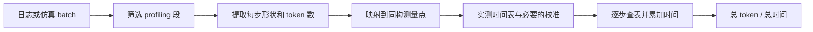

# Agent 任务下的 Prefill / Decode 吞吐估计

本仓库用真实请求或 forward batch 的形状分布，结合少量性能点测量，估计 Agent 负载下 Prefill（P）和 Decode（D）节点的吞吐。目标是解释当前负载的性能，并为容量规划提供可验证的输入。

## 从哪里开始

| 目的 | 文档 |
|---|---|
| 区分客户端吞吐、引擎步长和纯模型时间 | [指标与统计口径](docs/metrics.md) |
| 了解 Kimi-K3 的结果、覆盖率和限制 | [K3 实验结论](experiments/exp1_kimi_k3/Summary.md) |
| 用现有数据复算 K3 结果 | [K3 复现说明](experiments/exp1_kimi_k3/Reproduce.md) |
| 查看 α=0.8 形状统计实验与测量进度 | [统计实验报告](experiments/exp1_kimi_k3/stat_alpha0.8/Report.md) |
| 从日志提取 Prefill 形状并选点 | [Prefill 操作流程](prefill/SKILL.md) |
| 从 StepMembers 重放 Decode batch 并选点 | [Decode 操作流程](decode/SKILL.md) |
| 查找脚本、输入输出和依赖 | [脚本索引](scripts/README.md) |

## 两条估计路线

| 路线 | 输入与步骤 | 输出及适用范围 |
|---|---|---|
| 请求形状统计 | 请求分箱 → 代表点 → 固定并发实测 → 按分布汇总 | 该并发下的形状加权性能；不还原实际 batching |
| Forward batch 估计 | 日志 / 仿真 → 每步形状 → 等价同构点 → 测时 / 查表 → 累加时间 | 给定 batch 形状序列下的引擎吞吐或纯模型吞吐估计 |

请求形状路线见 [Prefill](prefill/Prefill_throughput_statistical_estimation.md) 和 [Decode](decode/Decode_throughput_statistical_estimation.md)。请求数加权的吞吐均值是统计指标；估计完成整批工作所需的时间时，应先累加工作量和耗时。

Forward 路线是 K3 案例的主线：

若每步已有可靠的 GPU 测时，可直接使用；缺少测时时才需要等价映射和性能表。推导见 [Prefill 工作量等价法](prefill/ragged_packed_prefill_workload_equivalence.md) 与 [Decode 工作量等价法](decode/ragged_packed_decode_workload_equivalence.md)。

K3 的 Prefill 形状来自原 CI，完整 Decode 形状来自本地重跑；历史 Prefill GPU 点表目前缺失，统计实验的 Decode 实测仍未覆盖全部代表点。可复算范围和部分结果的快照时间见上述实验文档。

## 如何测量

- Prefill：用缓存前缀构造已有上下文，用新 token 构造 query；在引擎侧确认实际 `(c, q, b)`。见 [Prefill 测点方法](prefill/measure_prefill_performance_point.md)。
- Decode：先准备每条请求自己的 KV，再重放相同 prompt；只采集目标 batch 的稳定 decode 步。见 [Decode 测点方法](decode/measure_decode_performance_point.md)。
- 只测客户端 serving 性能时，可采用 [独立 cache-replay](decode/standalone_aiperf_decode_cache_replay.md)；纯模型时间需要 [forward 探针](docs/forward_probe.md)。

## 解释结果时的约定

1. 所有吞吐同时说明 **token 分子、时间分母、采样窗口和覆盖率**。Prefill 的完整 ISL 包含缓存命中部分，fresh token 才是本次新算的 token。
2. GPU forward、引擎 step period、客户端 TTFT / ITL 分别计量。秒级日志只能支持形状重建和粗粒度时间分析。
3. 纯模型结果以当前模型实现、硬件、并行配置及 batch 分布为条件。改变并发、路由或节点数后，要重新评估 batch 分布。
4. P/D 配比先把两侧 tok/s 转成同一负载下的 req/s，再考虑 KV 传输、排队及延迟目标。

文档和核心脚本纳入 Git；大体积日志、Perfetto 文件、测量输出及历史草稿保留在本地。脚本默认从仓库根目录运行，外部输入和实验配置见各流程说明。
